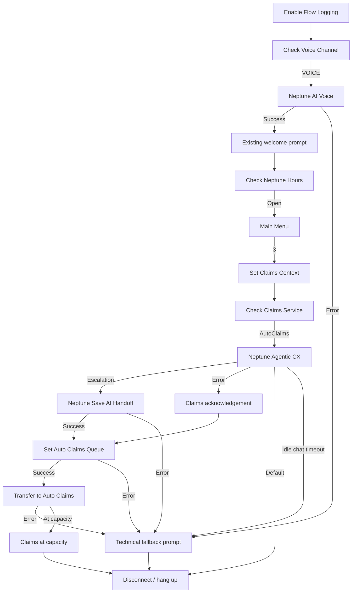

# Day 8 | Guardrails and AI-to-human handoff

Session date: **November 22, 2026 (America/Chicago)**. Configuration saved; application deployment and final contact-flow publication **reported by the project owner**. The end-to-end phone handoff pass gate is still pending.

## What was configured

Workspace: `Neptune Insurance Lab`. Application: `NeptuneInsurance`. The Connect block displays alias `Production`; a new Day 8 build/deployment was reported, but its version and deployment identifier were not captured. Do not invent a version or assume a display label alone proves which build ran.

| Conversational flow | Nodes and behavior |
| --- | --- |
| NeptuneHumanHandoff | Start → Escalate; fixed representative message and five Set modifications |
| NeptuneSupervisorHandoff | Start → Escalate; fixed supervisor-request message and five Set modifications |

The available application-default roles were Welcome, Fallback, Unknown and Incomprehension. Existing assignments were retained. There was no Escalation default in the learner's dialog; the input guardrail explicitly routes to the handoff flows instead.

## Typed handoff contract

| Context variable | Type | General handoff value | Supervisor handoff value |
| --- | --- | --- | --- |
| handoffReason | String | HumanRequested | SupervisorRequested |
| handoffSummary | String | Customer needs a Neptune representative. Confirm the request and any claim reference. | Customer requested a supervisor. Confirm the issue and arrange the supervisor process. |
| handoffClaimReference | String | NotProvided | NotProvided |
| supervisorRequested | Boolean | false | true |
| customerIntent | String | NeedsTriage | NeedsTriage |

These are **baseline fallback values**, not a generated conversation summary, authenticated identity, retrieved claim, or verified customer intent. Captured Day 7 slots have not yet been copied into this handoff contract. `NotProvided` and `NeedsTriage` are literal text entered by the learner. The schema editor's Auto-generate action accepted the sample JSON `false` to define a Boolean, rather than the text string `"false"`.

All five state modifications use **Set**. Clear would remove a value. Context-variable frontend updates were instructed Off for this internally written contract. The resource schemas/settings were reported configured; complete Agentic CX resource exports were not supplied.

## Guardrails

| Resource | Rule / detection | Saved enforcement |
| --- | --- | --- |
| NeptuneHumanRequests — Input | SupervisorRequest: supervisor, manager | Redirect → NeptuneSupervisorHandoff |
| NeptuneHumanRequests — Input | HumanRequest: human, representative | Override → Static, with a nonempty representative message; Route to → NeptuneHumanHandoff |
| NeptuneInsuranceOutput — Output | NoInsuranceDecisions: LLM Judge | Override → Static; fixed specialist-review response; optional route left empty |

The supervisor rule precedes the general-human rule. The general-human rule initially failed validation at `rules[1].enforcement.behavior.message`; the required message was then supplied and Save succeeded. Rule-array index 1 refers to the second rule.

Output detection instructions flag responses that make specific coverage, liability, fraud or payment decisions, while allowing general process explanations, specialist-review statements and statements that the AI cannot make these decisions. The fixed response is:

> A Neptune claims specialist needs to review that. I can help you request a representative.

Keyword detection has limited phrase coverage; an LLM judge can misclassify. Neither is a backend authorization control. No claims API, payment action, policy lookup, Generative Journey tool call or MCP tool was built or verified in this session.

## Contact flow wiring

This diagram focuses on the AI/claims journey. Policy Service still acknowledges and disconnects. Billing now selects the existing Neptune-Billing queue and transfers. The menu, one retry, lab-hours treatment, queue-capacity handling and technical fallback remain in the JSON.

`AutoClaims` on the connection is the condition output of Check Claims Service, not another block. Canvas position does not determine execution order; connections do. Set working queue selects a destination; Transfer to queue enqueues the contact, after which eligibility, state and capacity govern agent delivery.

### Returned data mappings

`Neptune Save AI Handoff` writes Current contact / User defined attributes. Each Value is dynamic, with Namespace **Agentic CX**, field **Context Variables**, and the corresponding context-variable name:

| Destination key | Source JSONPath |
| --- | --- |
| handoffReason | $.AgenticCX.ContextVariables.handoffReason |
| handoffSummary | $.AgenticCX.ContextVariables.handoffSummary |
| handoffClaimReference | $.AgenticCX.ContextVariables.handoffClaimReference |
| supervisorRequested | $.AgenticCX.ContextVariables.supervisorRequested |
| customerIntent | $.AgenticCX.ContextVariables.customerIntent |

The first namespace is the storage destination; the source namespace reads the AI result. Curly-brace placeholders used inside Designer are different from the JSONPath used by Connect. Mapping a field is configuration evidence, not proof an agent received or viewed its runtime value.

### Export interpretation correction

For this block, the console exports Default via the `NoMatchingCondition` transition and duplicates the Error destination in `NextAction`. The supplied export already sends Default to Disconnect. A previous reading that called that connection incorrect was corrected; no further Default rewiring is needed.

## Evidence and remaining work

| Evidence | What it proves | Status |
| --- | --- | --- |
| Pasted supervisor test transcript | Correct supervisor wording; application exited via Escalation | Observed |
| General-human application test | Success was reported; no complete transcript retained | Learner-reported |
| Supplied Neptune-Inbound-Voice (27).json | 26 reachable blocks, no empty/missing targets; dynamic mappings and routing wired | Static review passed |
| Final language correction and Publish | Owner reported enabling English (United States) language attribute and publishing | Reported; final export not supplied |
| Actual voice-to-agent delivery and two-way audio | Correct current deployment invoked, queue delivery and agent acceptance | Pending |
| Contact attributes at live handoff | Actual reason, supervisor flag and other values available downstream | Pending |
| Output-rule positive/negative tests; AI-unavailable and missing-context behavior | Guardrail effectiveness and recovery at runtime | Pending |
| Day 6 quick-connect retest | Human-initiated Billing-to-Auto Claims transfer | Pending |

## Snapshot provenance

The canonical public JSON in `connect/flows/Neptune-Inbound-Voice.json` is a **sanitized copy of the latest supplied export (27)**, not a reconstruction of the final published flow. It contains Joanna and PUBLISHED metadata but no explicit language attribute. The language fix and subsequent publication were reported after that file was supplied. Obtain the final post-correction export before treating the repository JSON as an exact backup of the final publication.

Resource bindings are placeholders. Retained PUBLISHED metadata describes the source snapshot and does not publish an imported copy. See [resource rebinding instructions](../connect/README.md).

## Resume here

1. Verify the current published flow/number association and the app build behind the selected alias.
2. Sign in an eligible Auto Claims test agent and set Available.
3. Make one controlled call using synthetic data: press 3, request a representative, then verify agent acceptance, two-way audio, and the five handoff attributes in appropriate private contact evidence.
4. Record the actual outcome and capture the final language-corrected flow export. Diagnose a concrete failure if the call does not pass; do not label the pass gate complete from the app test alone.

The small sandbox is not a load-tested 500-agent deployment. The static customer website, messaging, hosted chat and insurance backend integrations retain their separate scope and future acceptance gates.
