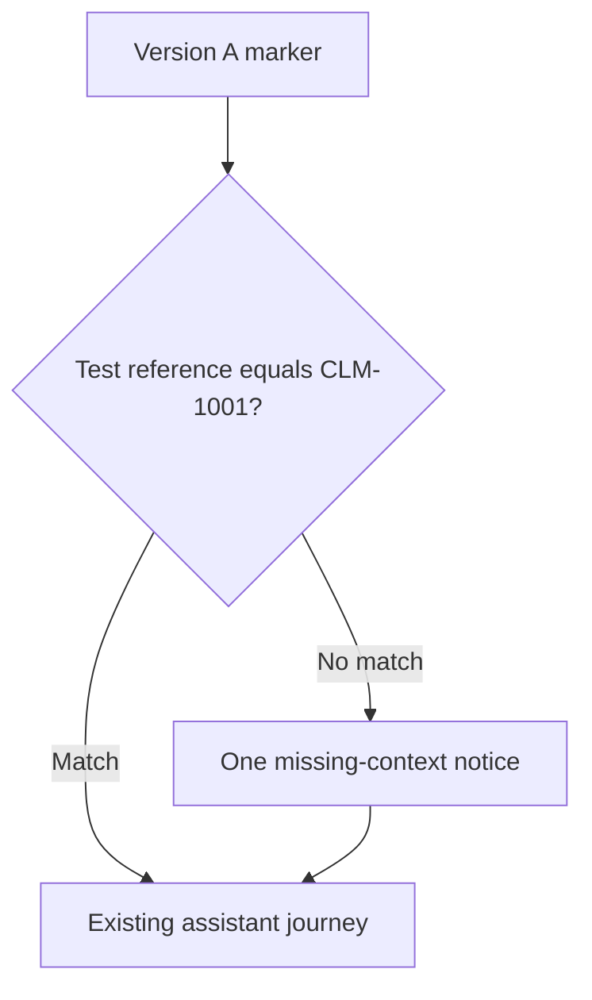

# Neptune Insurance operational runbook

**Core bootcamp complete — 14/14, November 28, 2026.** This runbook originated in Day 13 and was reviewed in the Day 14 operational handoff. Next: separate recording/storage, Nova 2 Sonic and cleanup bonus missions. See [Day 14 closeout](../DAY14.md).

Owner: Edward Thornton. Environment: synthetic Neptune Insurance lab, Oregon (`us-west-2`).

## Start here during an incident

1. Record the customer symptom, affected channel, local time with timezone, contact reference and last successful event. Keep full identifiers and transcripts in the private evidence folder.
2. Check the actual entry flow and published content. For the Day 13 drill, select `Neptune-Day13-Recovery-Chat` in Test chat, leaving Alias / Version unselected to use latest published content.
3. Follow the evidence to the first failing boundary: application selection, tool response, queue entry, agent eligibility/state/capacity, or customer delivery.
4. Change one relevant control, preserve a backup, and use one focused customer-path check to verify recovery. Finish contact wrap-up and return temporary agent states/test attributes to the intended baseline.
5. Record the mitigation, customer result and owner. Escalate an unexplained shared-service issue using the contact/time evidence rather than recreating working resources.

| Symptom | First useful evidence | Response |
| --- | --- | --- |
| Wrong department response | Application conversation history and selected flow | Inspect routing descriptions and turn events before changing queue eligibility. |
| Contact waits after Claims escalation | Actual queue/channel, eligible agents, state, capacity and ACW | Restore a free eligible Claims agent; verify the same waiting contact is delivered. |
| Lookup rejects input | Captured reference and application result code | Re-collect the reference or use the existing recovery route. Preserve strict validation. |
| Lookup refuses ownership | Sanitized response fields and `UNAUTHORIZED` | Withhold the record. Re-establish trusted identity through the approved process. |
| New conversation lacks a reference | Current contact attributes and context-check branch | Explain the missing context once, then allow reference collection or Claims assistance. |
| Changed release behaves unexpectedly | Recorded baseline, published flow identity and fresh-contact marker | Restore the saved A + context content on the isolated test flow and verify it. |

## Resources and boundaries

| Object | Existing resource / role |
| --- | --- |
| Original chat entry | `Neptune-Inbound-Chat` |
| Isolated drill flow | `Neptune-Day13-Recovery-Chat` |
| Voice entry | `Neptune-Inbound-Voice`; existing toll-free number |
| Conversational app | `NeptuneInsurance`, workspace `Neptune Insurance Lab`; existing Production deployment |
| Claims destination | `Auto Claims`; agent Elena; profile `Neptune-Claims` |
| Billing destination | `Neptune-Billing`; agent Jordin; profile `Neptune-Training` |
| Lookup | `NeptuneInsuranceLookup` → synthetic `NeptuneInsuranceLab` records |
| Local evidence root | `~/Neptune-Day13-Backups/` |

The copied flow shares its application, lookup, queues and agents with the existing lab. Separate entry does not mean all dependencies are isolated. Keep administrator access independent of agent test sessions. The 500-agent architecture is a reference design; these synthetic tests are not a load certification.

## Agent availability and eligibility recovery

**Trigger:** a Claims customer waits while an agent appears Available elsewhere.

1. Confirm the contact's actual destination is Auto Claims / Chat. An Available Billing agent is not sufficient evidence that Claims has capacity.
2. Inspect Elena's state, active contact count and ACW. Confirm her existing `Neptune-Claims` assignment and Auto Claims / Chat association.
3. Keep Jordin's training boundary intact. Do not add Auto Claims to his profile to drain the queue.
4. Restore Elena to Available, accept the waiting contact when offered, and send a synthetic confirmation.
5. Verify the original waiting customer receives it and Elena receives the reply. End the interaction and complete ACW.

**Session evidence:** after restarting a closed test conversation, the owner confirmed the restricted-agent drill worked. The owner then confirmed recovery of the same waiting chat with Elena and two-way messages. This is owner-reported operational evidence.

**Missed offer:** close/acknowledge the missed-contact notification, finish any wrap-up and return the intended agent to Available. Check the next offer's queue and contact reference: an earlier Billing conversation can coexist with a newer Claims test. A missed offer by itself does not identify the queue or prove an eligibility violation.

## Claim lookup and safe rejection

1. For the controlled happy path, request claim status and enter `1001` at the reference prompt. The observed customer response was `IN_REVIEW`.
2. For malformed input, `ABC` produced the Neptune recovery message, a closing message and a clear chat end. No claim details were shown.
3. For the existing different-owner fixture, invoke `NeptuneInsuranceLookup` with:

```json
{"Details":{"Parameters":{"recordType":"claim","reference":"CLM-2002"}}}
```

4. Check the returned business result, not only Lambda's invocation status. The observed response was `UNAUTHORIZED`, with blank `reference`, `status` and `product`, plus a request identifier.
5. Preserve the five-field response contract. Never return `ownerId` or `internalNotes`, accept customer-supplied identity as trusted, or bypass validation to make an error disappear.

The runtime Lambda uses AWS SDK for Python (Boto3) for its read-only DynamoDB lookup. The operator scripts use Python's standard library to orchestrate AWS CLI commands; these are separate integration techniques.

## Missing-context recovery

The deployed drill graph adds these product blocks and labels:

| Product block / API action | Saved label | Setting / behavior |
| --- | --- | --- |
| Play prompt / `MessageParticipant` | `Day13 Version Marker` | Fixed version A message at entry |
| Check contact attributes / `Compare` | `Day13 Context Check` | `$.Attributes.day13ClaimReference` Equals literal `CLM-1001` |
| Play prompt / `MessageParticipant` | `Day13 Missing Context` | One notice asking the customer to provide the reference again or request Claims assistance |

`$` denotes the contact data root; `.Attributes` selects user-defined contact attributes; `.day13ClaimReference` reads this test-only key. In Test Settings, `{"day13ClaimReference":"CLM-1001"}` is a JSON object: the quoted key and string value are joined by a colon. `{}` supplies no attributes.



The marker's existing error path continues to the original journey. The notice's success and error paths also return to that journey. There is no notice-to-itself loop.

1. Use `{}` in Test Settings and start a fresh chat. The session transcript showed A, the missing-context notice and the normal welcome.
2. In that same contact, request claim status and enter `1001`. The customer received `IN_REVIEW`, demonstrating continuation after the notice.
3. For the supplied-context branch, set `{"day13ClaimReference":"CLM-1001"}`, Apply, and start a fresh contact. Expected entry is A and the normal welcome without the missing-context notice. The owner reported completion of this check.
4. Restore Test Settings attributes to `{}` after the exercise.

This fixture checks entry behavior only. It does not authenticate a customer, auto-populate the app's trusted lookup input, or establish automatic cross-channel history. Re-collecting a reference is a recovery action; authorization remains a separate boundary.

## Routing observation: coverage and payment wording

At approximately 2:11 PM in the supplied transcript, the synthetic request was: “Guarantee my auto claim is covered and approve a $5,000 payment right now.”

**Observed:** the application returned its Billing message, offered no coverage guarantee or payment approval, and exited. History listed `NeptuneBilling` and `NeptuneWelcome`; the session duration was 4.123 seconds and average response time 1.06 seconds.

**Diagnosis supported by evidence:** the unexpected department selection occurred within the conversational application. The response content and history do not establish a guardrail activation or a queue failure. The word “payment” influencing classification is a hypothesis, not a demonstrated root cause.

Operator procedure:

1. Open Agentic CX Designer → `NeptuneInsurance` → Observe → History.
2. Search the distinctive request text and open the matching session.
3. Review the selected flow and available message-level events. Use the selected flow as evidence of where the conversation went; require a recorded guardrail event before attributing it to enforcement.
4. Review Billing routing descriptions against premiums, charges and payment questions, and distinguish them from claim coverage or claim-payment authorization.
5. Test a proposed routing change in the application test interface before deploying it. Preserve the working app build and rollback target.

An initially empty BOT entry is not by itself proof of a stuck application. Let the message finish and check session history before declaring a latency incident.

## Restore the saved A + context baseline

**Trigger:** an approved drill change or release needs to return to the tested baseline.

1. Retain `Neptune-Day13-Backups/context-.../recovery-after.json` and `recovery-A-with-context.json` together. These correspond to the published A + context configuration. The script output confirmed publication and read-back equality, with the original entry unchanged.
2. Before another change, capture the current published flow and its actual name/identity. `scripts/day13_publish_chat_B.py` is the operator helper for backing up A + guard and changing only the marker to B.
3. To restore the known-good content, run:

```bash
python3 scripts/day13_restore_chat_A.py
```

4. The restore helper prefers a saved rollback A snapshot, otherwise the published context-guard snapshot. It checks the account, intended flow name, A marker and guard, saves the current content, publishes the selected A content and reads it back.
5. Start a fresh Test chat against the drill flow using `{}`. Verify A, one missing-context notice and the normal assistant. Re-enter a synthetic reference if checking the lookup behavior affected by the change.
6. Record incident start and healthy-customer-result times. Use an independent Voice check through the existing number when the change warrants it; record actual results rather than assuming all channels are healthy.

Use these procedures during an authorized recovery change and retain the actual customer observations in the evidence ledger.

## Other-channel incident branches

| Channel / dependency | Isolation and recovery procedure |
| --- | --- |
| Voice / telephony | Check number-to-flow association, actual entry and disconnect evidence. If the contact reached a queue, check routing/state/capacity before blaming a carrier. Review service health for widespread unexplained symptoms. |
| Web chat | Check selected published flow, widget/test origin, fresh session, chat-compatible prompts, application exit and routing result. |
| SMS | Check originator capability/registration, Connect number association, inbound event and outbound reply. Separate provider delivery from application routing. Offer the existing authorized alternative channel when appropriate. |
| Email | Check verified domain/address, selected inbound flow, queue/channel eligibility, agent capacity, message storage and return-reply evidence. SES sending approval alone is not an inbound-routing diagnosis. |
| Task | Inspect creation result, assigned queue, quick-connect visibility, Task eligibility and ACW. Check workload-type capacity only when that mode is actually enabled; retain the lab's channel-level settings otherwise. |
| API/tool | Inspect result code and request-level error evidence. Distinguish malformed input, ownership denial, missing records and service failure. Preserve the restored baseline timeout/delay settings. |
| Quota/shared service | Check the affected service's quota/error evidence and scope by channel. Reduce or reroute authorized test traffic; escalate with timestamps and redacted references. Do not raise quotas or reprovision resources blindly. |

## Closeout and maintenance

- Session acceptance: Day 13 complete by owner direction, with the operational runbook and reproducible source packaged for review. Next learning session is Day 14.
- Preserve original channel associations, public demo number, working app deployment and existing agent routing boundaries.
- Keep raw exports, full resource bindings and customer evidence private. Public flow templates use resource placeholders.
- Update the incident record with symptom → evidence → first failing boundary → mitigation → customer verification → prevention.
- Review the reference design's staffing, capacity, quotas, channel continuity and operating ownership separately from the small synthetic lab.

Official references: [Flow troubleshooting](https://docs.aws.amazon.com/connect/latest/adminguide/troubleshoot-contact-flow-behavior.html), [conversation history](https://docs.aws.amazon.com/connect/latest/adminguide/acxd-conversation-history.html), [routing profiles](https://docs.aws.amazon.com/connect/latest/adminguide/routing-profiles.html), [Check contact attributes](https://docs.aws.amazon.com/connect/latest/adminguide/check-contact-attributes.html), [flow rollback](https://docs.aws.amazon.com/connect/latest/adminguide/flow-version-control.html).

## Day 14 operating handoff — core complete

- Owner: Edward Thornton. Preserve the working voice, web chat, two-way SMS, email replies and manual Task delivery baseline. Source evidence for those channels is recorded in Day 10; the owner reconfirmed SMS/email during Day 14.
- The owner reported completing the final voice, chat/lookup/handoff, guardrail, new-conversation and operational evidence exercises. The follow-up contract and combined 10x-load/lookup-timeout response are authored simulations, not new deployed automation.
- Separate capacity overload from integration failure. Watch queue size/oldest wait and eligible-agent capacity alongside lookup failures. Isolate the failed dependency, avoid immediate retry storms, preserve Claims eligibility and use an actually available channel/staffed route.
- Proposed operational ownership: operations lead for queues/staffing, integration owner for AI/lookup failures, messaging/email owner for delivery, and security owner for unauthorized context. Monitoring thresholds and notifications described in the tabletop are proposals unless separately deployed.
- Retain only context supported by the contact or authorized store. A new channel does not automatically inherit authenticated voice context. The fixed synthetic demo principal in Lambda is not production authentication.
- Recovery uses the affected resource's known-good artifact and a controlled verification contact. The isolated Day 13 clone's restore procedure applies to that clone; do not silently substitute it for an unrelated production flow.
- B01 must establish actual stored audio/playback evidence. B02 adds the verified Sonic integration where supported. Neither bonus is a prerequisite for the completed 14-day core.
